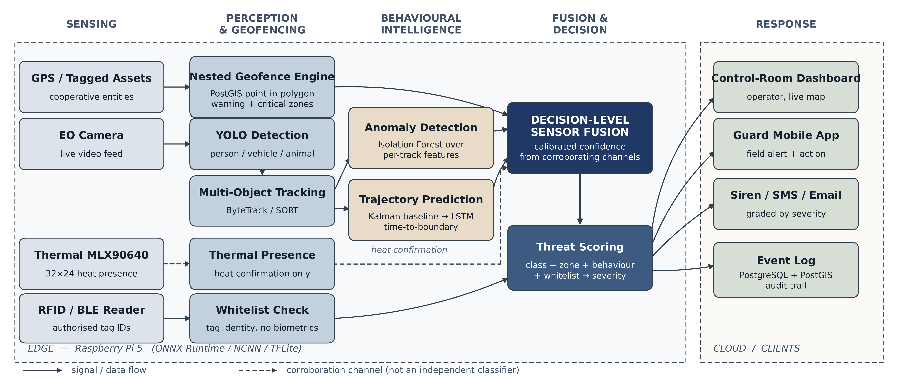
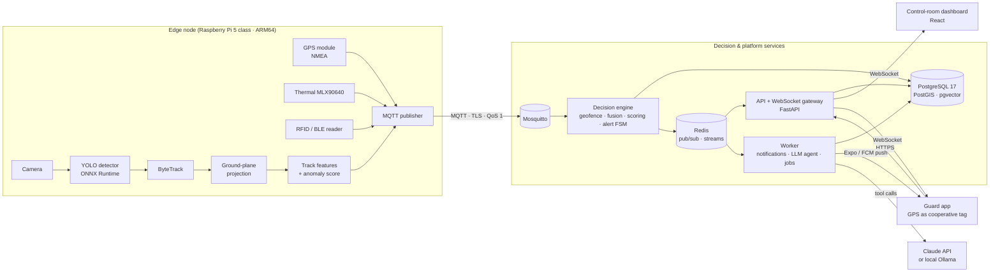

# Architecture overview

## 1. System context

## 2. Components

| Component | Package | Responsibility |
|-----------|---------|----------------|
| **Decision core** | `packages/core` (`pids_core`) | Contracts, coordinate frames, nested-zone geofencing, per-track features, Kalman forecasting, spoofing checks, fusion, threat scoring, alert state machine. **Pure — no I/O**, so it runs identically on the edge, in the server and in the evaluation harness. |
| **Simulator** | `packages/sim` (`pids_sim`) | Labelled scenarios (intruders, patrols, tagged assets, animals, road traffic, loiterers, spoofed tags) emitted through the *same contracts* as real sensors. Live mode publishes to MQTT; batch mode feeds the core directly for evaluation. |
| **Edge node** | `apps/edge` (`pids_edge`) | Sensor drivers (camera, GPS, thermal, tag reader — each real or simulated behind one interface), detection, tracking, ground-plane projection, feature extraction, MQTT publishing with offline buffering. |
| **Server** | `apps/server` (`pids_server`) | One image, three processes: `api` (REST, auth, WebSocket gateway), `decision` (consumes telemetry, runs the core, persists and publishes), `worker` (notification dispatch, LLM agent, scheduled jobs). |
| **Dashboard** | `apps/dashboard` | Operator UI: live map, alert queue, fusion breakdown, incident review, zone management, agent chat. |
| **Guard app** | `apps/guard` | Android (Expo / React Native): push alerts, alert detail and instruction, acknowledge/resolve, shares own GPS as a cooperative tag. |
| **ML & evaluation** | `ml` (`pids_ml`) | Anomaly-model training, detector export/benchmarks, trajectory models, the baseline-vs-PIDS evaluation harness and paper figures. |

## 3. Messaging

MQTT topics (`infra/mosquitto/acl` enforces who may publish what):

| Topic | Publisher | Payload |
|-------|-----------|---------|
| `pids/{site}/{node}/tracks` | edge | `TrackBatch` — tracks seen in one perception cycle |
| `pids/{site}/{node}/gps` | edge | `GpsFix` from a tag / GPS module |
| `pids/{site}/{node}/sensors` | edge | thermal presence, tag reads |
| `pids/{site}/{node}/health` | edge | `NodeHealth` — retained; FPS, inference time, tracks; `offline` last will |
| `pids/{site}/{node}/view` | edge | `NodeView` — retained; the camera's ground footprint and pixel→metres homography |
| `pids/{site}/{node}/cmd/{name}` | server | commands to a node (e.g. siren) |

Inside the platform, the decision engine publishes assessments and alerts to Redis;
the API fans them out to WebSocket clients and the worker consumes alert jobs from a
Redis stream (durable, acknowledged).

## 4. Latency budget (NFR-01: breach → alert < 2 s)

| Hop | Budget |
|-----|--------|
| Frame capture → detection + tracking | ≤ 150 ms |
| Edge → broker → decision engine | ≤ 50 ms |
| Fusion, scoring, alert decision | ≤ 10 ms |
| Persist + publish | ≤ 50 ms |
| WebSocket to dashboard | ≤ 50 ms |
| Push notification to phone (FCM, external) | ≤ 1.5 s |

Each message carries the timestamps of every hop it has passed, so latency is
measured, not estimated, and exported as Prometheus histograms.

## 5. Coordinate frames

- **WGS84** (lat/lon) for storage, GPS input and maps.
- **Local ENU metres** (east/north from a per-site origin) for all kinematics:
  speeds, distances, Kalman state and features. Converted with `pyproj`.
- **Image pixels** from the camera, mapped to ENU through a per-camera ground-plane
  homography calibrated from four or more surveyed points.

## 6. Deployment topologies

**Demo (27 Oct):** everything on one ARM64 laptop. Infrastructure in Docker; the edge
node runs natively because Docker on macOS cannot reach USB cameras or serial GPS.

**Target:** edge node and a local broker on the Pi 5; the broker bridges telemetry to
the cloud broker; server services and clients in the cloud.

## 7. Security model (summary)

- Every MQTT client authenticates; ACLs confine an edge node to its own topics.
  TLS on 8883 for anything leaving localhost.
- API: short-lived JWT access tokens + rotating refresh tokens, RBAC (admin /
  operator / guard), rate limiting, audit log of operator actions.
- LLM agent: read-only data access; any action it proposes requires operator approval.
- Privacy: tag-based identity (no biometrics); frames processed in memory and not
  stored by default; location-history retention limits (DPDP Act).
