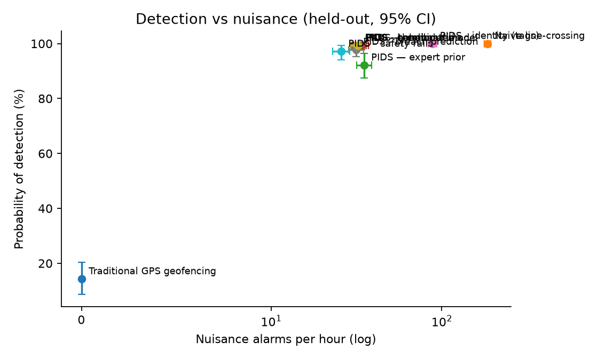
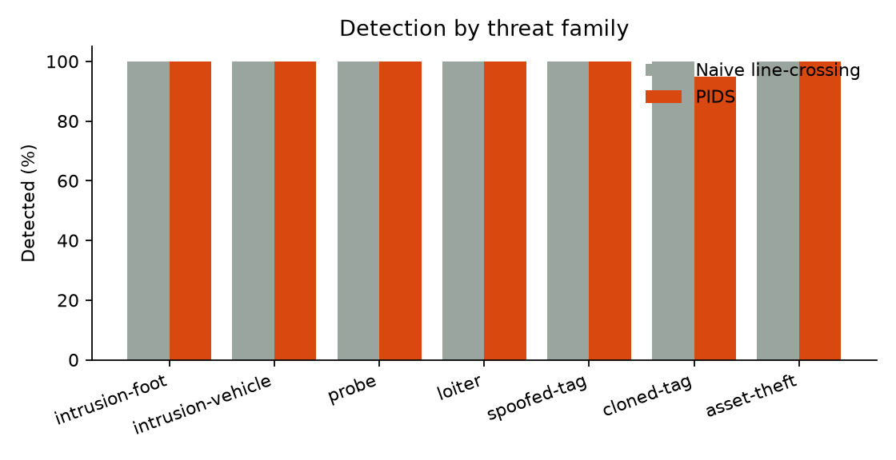
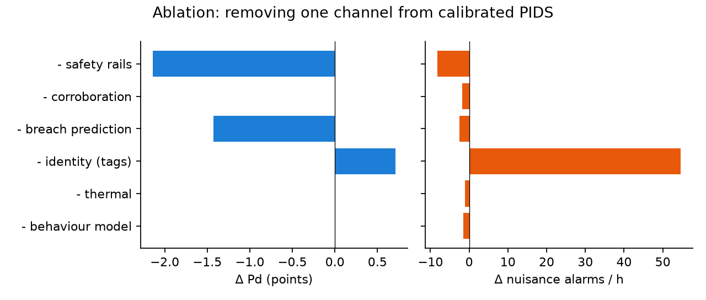

# Evaluation results

> Generated by `make eval` on 2026-10-16 — do not edit by hand.

## Protocol

- **Site:** Site Alpha (`config/sites/site-alpha.yaml`): 4 camera nodes (2 with thermal), a gate reader,
  nested warning/critical zones and an armoury containment zone.
- **Scenarios:** 8 families x 20 held-out seeds (≥ 10000) of 5 minutes = 13.3 h simulated. Each contains normal site activity (patrols with GPS phones,
  public-road traffic through the warning band, animals, staff badging in, a quick-reaction
  vehicle, a stored asset) plus at most one threat.
- **Models** were trained on seeds 0-999 only. Every engine sees identical inputs and shares
  the alert state machine, so differences are decision logic alone.
- **Pd:** a threat is detected if an alert attributed to it reaches WARNING. **NAR:** RAISED
  alerts on non-threats or ghost tracks per hour. **Lead:** breach time - first alert.
- **Intervals:** 95 % cluster bootstrap over scenarios (1000 resamples).

## Headline

| Engine | Pd (95 % CI) | Nuisance alarms / h (95 % CI) | Median lead |
|---|---|---|---|
| Traditional GPS geofencing | **14.3 %** (8.7 %-20.3 %) · 20/140 | **0.0** (0.0-0.0) | -90.0 s |
| Naive line-crossing | **100.0 %** (100.0 %-100.0 %) · 140/140 | **185.5** (177.2-192.9) | 107.3 s |
| PIDS — expert prior | **92.1 %** (87.4 %-96.4 %) · 129/140 | **35.0** (31.6-38.7) | 14.8 s |
| PIDS — calibrated | **99.3 %** (97.7 %-100.0 %) · 139/140 | **33.9** (30.7-37.3) | 68.7 s |

Calibrated PIDS detects 99.3 % of intrusions against 100.0 % for naive line-crossing over the same detections, while raising **82 % fewer nuisance alarms**.

## Ablations (calibrated PIDS minus one channel)

| Variant | Pd | Δ Pd | NAR / h | Δ NAR |
|---|---|---|---|---|
| - behaviour model | 99.3 % | +0.0 pt | 32.3 | -1.6 |
| - thermal | 99.3 % | +0.0 pt | 32.8 | -1.1 |
| - identity (tags) | 100.0 % | +0.7 pt | 88.5 | +54.6 |
| - breach prediction | 97.9 % | -1.4 pt | 31.4 | -2.5 |
| - corroboration | 99.3 % | +0.0 pt | 32.2 | -1.7 |
| - safety rails | 97.1 % | -2.1 pt | 25.7 | -8.2 |

## By threat family

| Family | Naive line-crossing | PIDS — calibrated |
|---|---|---|
| normal | no threat, 177.0 nuisance/h | no threat, 27.6 nuisance/h |
| intrusion-foot | 20/20 detected, 180.6 nuisance/h | 20/20 detected, 36.6 nuisance/h |
| intrusion-vehicle | 20/20 detected, 202.2 nuisance/h | 20/20 detected, 42.0 nuisance/h |
| probe | 20/20 detected, 178.8 nuisance/h | 20/20 detected, 36.6 nuisance/h |
| loiter | 20/20 detected, 187.2 nuisance/h | 20/20 detected, 29.4 nuisance/h |
| spoofed-tag | 20/20 detected, 195.0 nuisance/h | 20/20 detected, 39.6 nuisance/h |
| cloned-tag | 20/20 detected, 171.6 nuisance/h | 19/20 detected, 27.6 nuisance/h |
| asset-theft | 20/20 detected, 192.0 nuisance/h | 20/20 detected, 31.8 nuisance/h |

## Decision latency

`DecisionEngine.step` over a busy scenario (4.1 entities on average, 600 steps): p50 **2.12 ms**, p99 20.75 ms, max 47.06 ms. Live end-to-end capture → decision measured on the demo stack: ~170 ms (NFR-01 target < 2 s).

## Behaviour model (Isolation Forest, held-out tracks)

On 62506 non-cooperative track windows (23991 alert-worthy): AUC **0.660**, average precision 0.579, precision 0.578 / recall 0.394 at p ≥ 0.5. It is one evidence channel among several, so recall here is not the system's Pd.

## Figures





## Reproduce

```bash
make train   # models from training seeds 0-999
make eval    # this report (pids-eval -n 20)
```
